<div align="center">

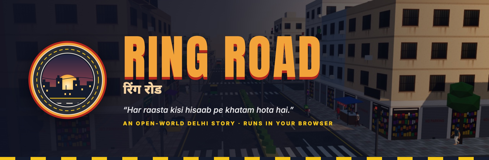

<br>

**An original, Delhi-inspired, single-player open-world game that runs in your browser.**<br>
Ride a delivery bike through Kamla Nagar traffic, talk your way past a police naka, and pay off a family debt that was never an accident.

<br>


-654FF0?style=flat-square&logo=webassembly&logoColor=white)


[**Play locally**](#-getting-started) · [**Screenshots**](#-screenshots) · [**Features**](#-features) · [**Controls**](#-controls) · [**Architecture**](#-architecture) · [**Roadmap**](#-roadmap) · [**Design doc**](docs/GDD.md)

</div>

---

## 🛺 About

**RING ROAD** (codename *Project Dilli*) is a story-driven open-world game set in a stylised, compressed North Delhi: Kamla Nagar's markets, the lanes of Shakti Nagar, the Ring Road, and the prayer-flag colony of Majnu Ka Tila.

You play **Aryan Sethi**, a 23-year-old delivery rider who knows every shortcut in the north of the city. On his little sister's birthday, men from *the Kothi* arrive at the family's door with a ledger: **₹14,00,000** owed. Paying it back pulls Aryan into the city's paper trail of favours, loans and quiet threats, and eventually forces him to decide who he really owes.

The whole theme is ***hisaab***: accounts owed, in money, loyalty and love.

> *"Har raasta kisi hisaab pe khatam hota hai."*<br>
> Every road ends at a settling of accounts.

### Design pillars

| | |
|---|---|
| 🏍️ **Driving is the core verb** | Arcade bike and car handling through dense, keep-left Delhi traffic that honks, yields and pushes through junctions. |
| 🎬 **Cinematic, in-engine storytelling** | Data-driven cutscenes with camera cuts, letterboxing, branching dialogue and choices that are remembered. |
| 🗣️ **Delhi in its own voice** | Hinglish dialogue with English subtitles, street slang, and Devanagari + English signboards. |
| 🌐 **Runs anywhere** | No install: a WebGL game tuned for low-end laptops (about 70 draw calls on the low preset). |

---

## 📸 Screenshots

<table>
  <tr>
    <td width="50%">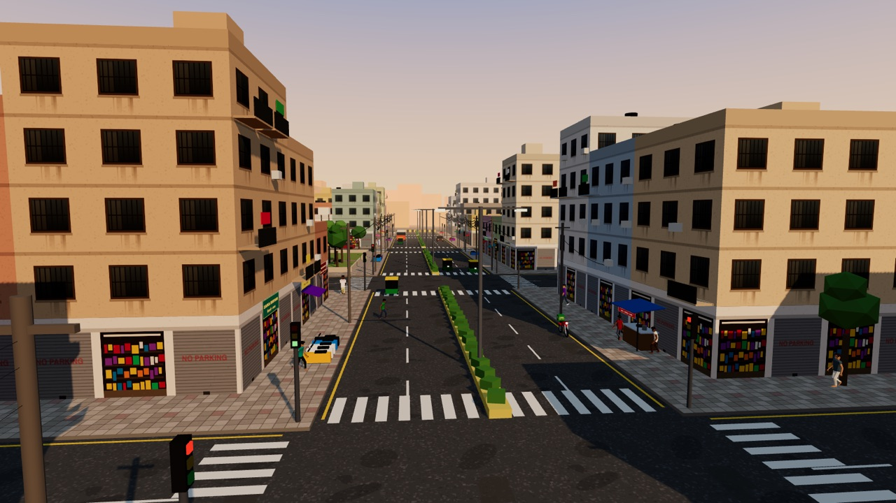</td>
    <td width="50%">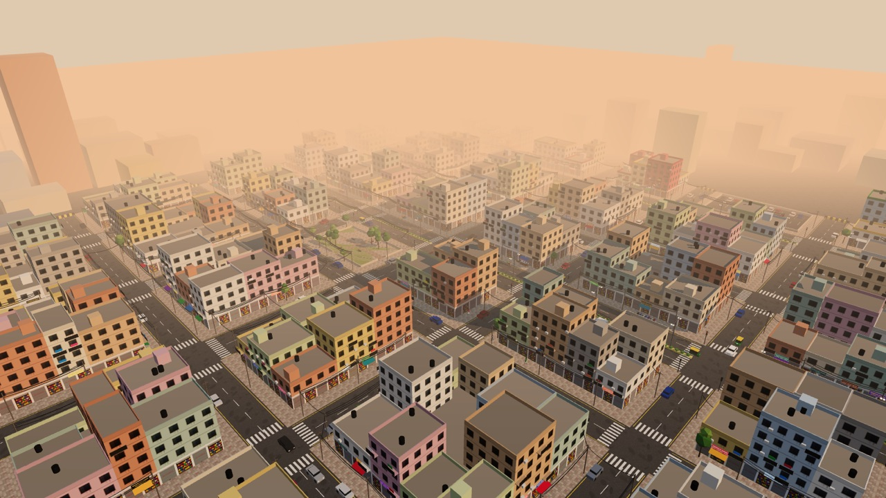</td>
  </tr>
  <tr>
    <td align="center"><sub><b>Kamla Nagar main road</b>: median, signals, shopfronts and traffic</sub></td>
    <td align="center"><sub><b>The procedural city</b> under the evening haze</sub></td>
  </tr>
  <tr>
    <td>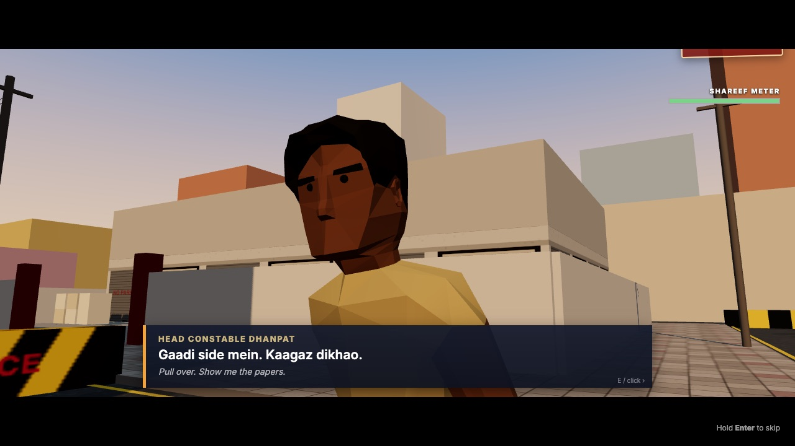</td>
    <td>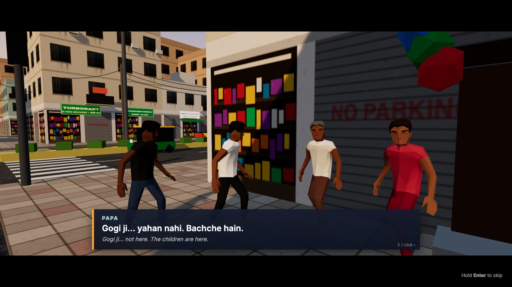</td>
  </tr>
  <tr>
    <td align="center"><sub><b>Mission 2</b>: the police naka. <i>"Gaadi side mein. Kaagaz dikhao."</i></sub></td>
    <td align="center"><sub><b>Mission 1</b>: the Kothi's men arrive at Pihu's birthday</sub></td>
  </tr>
  <tr>
    <td>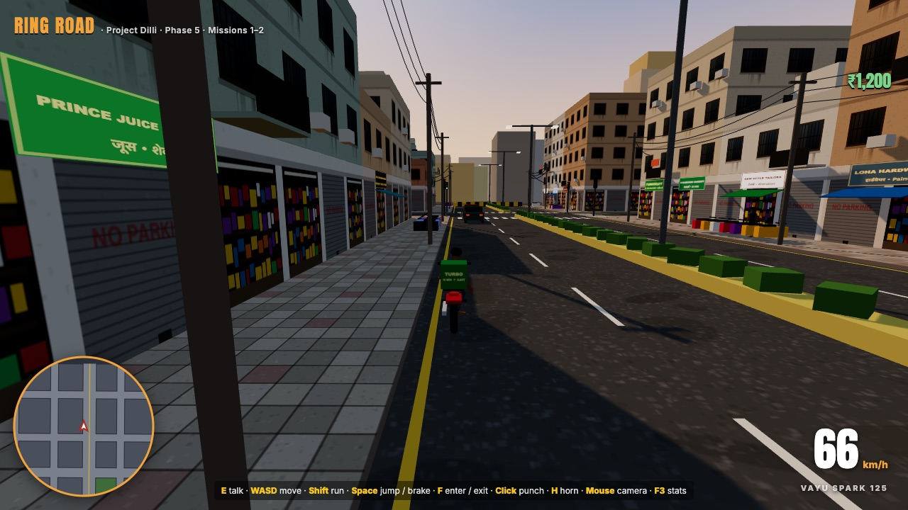</td>
    <td>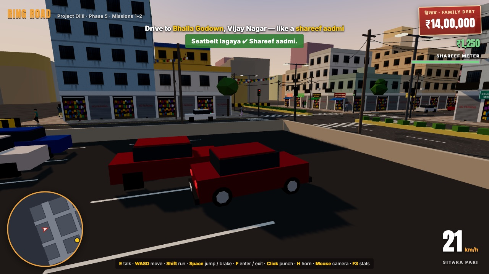</td>
  </tr>
  <tr>
    <td align="center"><sub><b>Vayu Spark 125</b>: speedometer, minimap and wallet</sub></td>
    <td align="center"><sub><b>Shareef Driving</b>: debt counter, shareef meter and objective</sub></td>
  </tr>
  <tr>
    <td>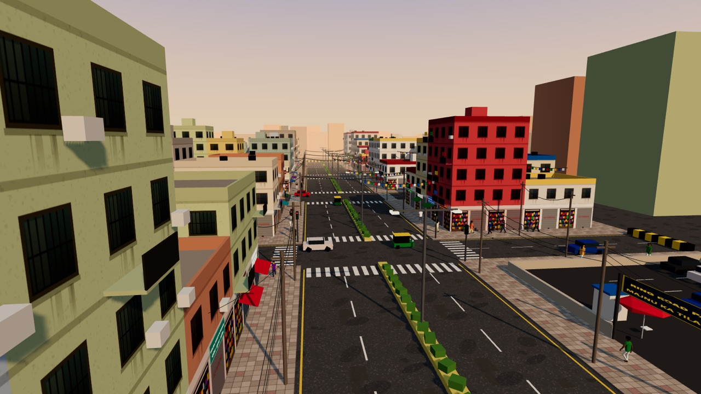</td>
    <td>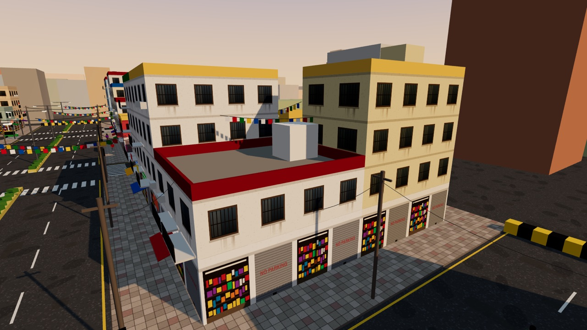</td>
  </tr>
  <tr>
    <td align="center"><sub><b>Ring Road</b>: six lanes and timed traffic signals</sub></td>
    <td align="center"><sub><b>Majnu Ka Tila</b>: white and maroon buildings, prayer flags</sub></td>
  </tr>
</table>

<details>
<summary><b>More screenshots</b></summary>
<br>
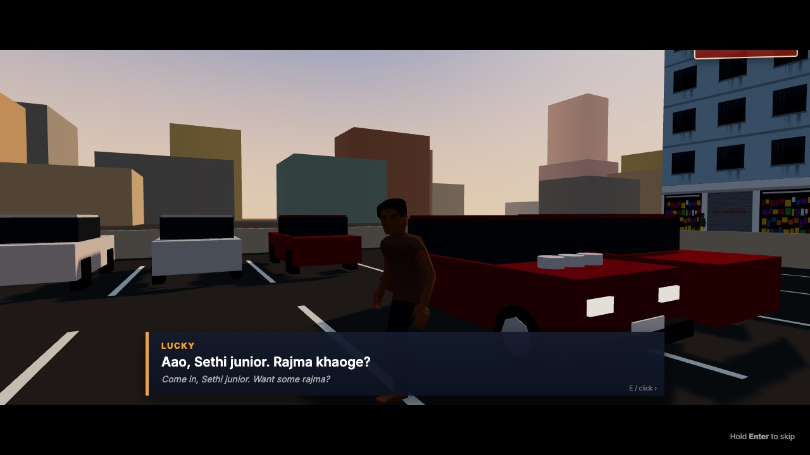
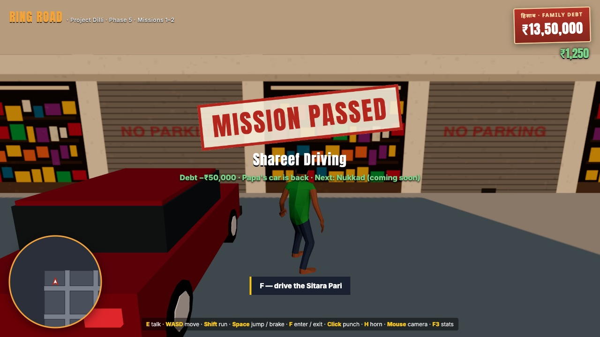
</details>

<sub>All screenshots were captured from the current build by the automated playthrough tests.</sub>

---

## ✨ Features

### Playable today

- **A living North Delhi pocket.** A procedurally built city: about 25 blocks of markets, colonies, a park, a parking lot and a paper godown, with bilingual signboards, overhead wires, scooters and a chai stall, all lit for golden hour.
- **Two vehicles with distinct feel.**
  - The *Vayu Spark 125* bike: lean, kerb hops, handbrake.
  - The *Sitara Pari* family car: right-hand drive, handbrake drift, body roll.
- **Traffic AI that feels like Delhi.**
  - Hatchbacks, sedans, autos and DTS buses keep left, follow the vehicle ahead and make curved turns.
  - They yield at busy junctions, then push through.
  - They honk at you.
  - They obey the timed traffic signals at the 10 major junctions.
- **Crowds.**
  - Up to 60 instanced pedestrians walk pavement loops, sidestep you, flee from horns and bikes, and shout Hinglish barks.
  - The nearest ones switch to fully animated, individually coloured characters.
- **Story missions with real cutscenes.**
  - **M1 "Happy Birthday, Pihu"**: buy the cake, get it home in one piece, and survive the debt reveal.
  - **M2 "Shareef Driving"**:
    - Drive a car full of something you shouldn't ask about like a law-abiding citizen.
    - A *shareef meter* tracks speeding, red lights, honking, crashes, pavement driving, the wrong side and your seatbelt.
    - Then a branching police checkpoint scene.
- **Mission system.** Stages with checkpoints, MISSION FAILED with automatic retry, start markers on the minimap, and choices saved as story flags.
- **Dialogue.** A typewriter dialogue box, Hinglish lines with English subtitles, 1/2/3 choices and phone-style texts.
- **HUD.** Rotating minimap, objective line, 3D beam markers, wallet, debt counter, mission stamps and a speedometer.
- **Save system.** A versioned localStorage save holds money, debt, flags, completed missions and mid-mission checkpoints.
- **Synthesised audio.** Engine sounds with a fake gearbox, a two-tone horn, crash thumps and a city ambience bed.

### Coming next

Free-roam police *challans* (Heat 1) · M3 "Nukkad" (street play, foot chase, a three-way choice) · melee combat · phone UI · knife, pistol and one AK-47 for late-story set pieces · Old Delhi, Hauz Khas and Connaught Place districts. See the [roadmap](#-roadmap).

---

## 🚀 Getting started

**Requirements:** [Node.js](https://nodejs.org) 20.19+ or 22.12+ and a WebGL2 browser (Chrome, Edge, Firefox or Safari). The automated tests also need **Google Chrome** installed.

```bash
git clone https://github.com/Heisenberg300604/GTA-Delhi.git
cd GTA-Delhi/web
npm install
npm run dev
```

Open **http://localhost:5173** and click to play.

| Option | How |
|---|---|
| Quality preset | `?q=low`, `?q=medium` or `?q=high`, for example `http://localhost:5173/?q=low` |
| Performance stats | Press **F3** (FPS, draw calls, triangles, player state) |
| New game | Press **N** on the title screen (clears the save) |
| Play from another device on your Wi-Fi | `npm run dev -- --host`, then open the printed Network URL |
| Production build | `npm run build`, then `npm run preview` |

---

## 🎮 Controls

| Action | On foot | On the bike / in the car |
|---|---|---|
| Move / steer | <kbd>W</kbd> <kbd>A</kbd> <kbd>S</kbd> <kbd>D</kbd> | <kbd>W</kbd> accelerate · <kbd>S</kbd> brake / reverse · <kbd>A</kbd> <kbd>D</kbd> steer |
| Run / handbrake | <kbd>Shift</kbd> run | <kbd>Space</kbd> handbrake |
| Jump | <kbd>Space</kbd> | n/a |
| Enter / exit vehicle | <kbd>F</kbd> | <kbd>F</kbd> |
| Talk / interact | <kbd>E</kbd> | n/a |
| Punch | Left click | n/a |
| Horn | n/a | <kbd>H</kbd> |
| Seatbelt (Mission 2) | n/a | <kbd>B</kbd> |
| Camera | Mouse | Mouse |
| Dialogue | <kbd>E</kbd> / <kbd>Space</kbd> / click to advance · <kbd>1</kbd> <kbd>2</kbd> <kbd>3</kbd> to choose | |
| Skip a cutscene | Hold <kbd>Enter</kbd> | |

---

## 🏗️ Architecture

The game is a **plain, imperative Three.js engine** (no React Three Fiber) with a fixed-timestep simulation and interpolated rendering. The engine never imports UI code; the HUD is driven through small methods, ready to move to React for menus later.

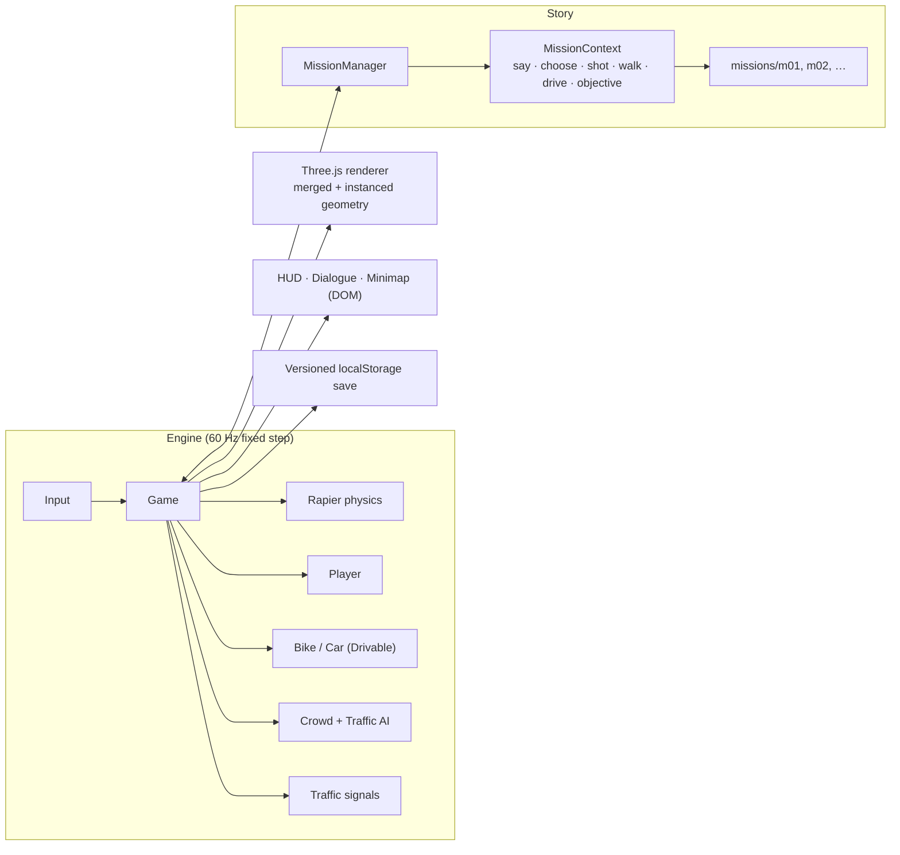

<details>
<summary><b>Project layout</b></summary>

```
.
├── web/                      # the game (Vite + TypeScript + Three.js + Rapier)
│   ├── src/
│   │   ├── engine/           # fixed-step loop, input, synthesised audio
│   │   ├── physics/          # Rapier wrapper (static boxes, rays)
│   │   ├── world/            # procedural city, layout data, textures, sky, signals
│   │   ├── player/           # kinematic controller, animated character, rigs
│   │   ├── vehicles/         # bike + car controllers, vehicle models
│   │   ├── ai/               # instanced crowd, traffic AI
│   │   ├── camera/           # orbit camera with collision + cutscene shots
│   │   ├── story/            # mission runtime, cast, mission scripts
│   │   ├── save/             # versioned save manager
│   │   ├── ui/               # HUD, dialogue box, minimap
│   │   ├── debug/            # F3 stats overlay
│   │   └── config.ts         # every tuning value and quality preset
│   ├── scripts/              # headless smoke test + full mission playthroughs
│   └── public/assets/        # exported GLBs
├── tools/
│   ├── blender/              # headless Blender scripts (FBX → GLB, palette textures)
│   └── branding/             # source for the logo and banner
├── assets-src/               # source art (FBX / .blend)
└── docs/                     # GDD, checklist, asset log, media
```
</details>

### Engineering highlights

- **Draw-call budget.**
  - Static city geometry is merged per material, and repeated props are GPU-instanced.
  - The low preset stays at about **70 draw calls / 110k triangles**; high is about 140 at 60 fps on Apple silicon.
- **Missions as screenplays.**
  - Missions are async scripts built from primitives (`say`, `choose`, `shot`, `walk`, `drive`, `objective`, `interact`, `fail`).
  - Every stage is a checkpoint; a failure restores the stage's variables and retries it automatically.
- **Character pipeline.**
  - A CC0 base mesh is converted with headless Blender into a GLB with named animation clips.
  - Outfits are recoloured at runtime from a generated 32×32 palette texture, so one mesh gives every character a unique look.
- **Physics that doesn't snag.**
  - Vehicles float a collider above the ground and get their ride height from a filtered downward ray.
  - This avoids the classic character-controller snagging on flat ground.
- **India-first traffic logic.** Keep-left lane offsets, right-hand-drive cars, signal phases with an all-red gap, and honking that is part of the soundscape.

---

## 🧪 Testing

Every feature is covered by **headless playthroughs**. They drive the real game in Chrome with simulated key presses, assert on game state, and save screenshots for review.

```bash
cd web
npm run dev            # keep the dev server running in another terminal
npm run typecheck
npm run smoke          # 17 checks: spawn, crowd, traffic, bike, car, camera, no errors
npm run test:m01       # 18 checks: Mission 1 end to end
npm run test:m02       # 22 checks: Mission 2 end to end, including fail and retry
```

---

## 🗺️ Roadmap

| Phase | Scope | Status |
|---|---|---|
| 0 · Design | Game design document: story, 10 missions, districts, systems, budgets | ✅ Done |
| 1 · Greybox prototype | Engine loop, input, player, camera, bike, audio, HUD | ✅ Done |
| 2 · First Delhi block | Procedural city, crowds, traffic AI, ambience | ✅ Core done (recorded audio pending) |
| 3 · Characters & vehicles | Animated Aryan, skinned pedestrian LOD, the family car | ✅ Core done (female models, driving animations pending) |
| 4 · First mission | Mission runtime, cutscenes, dialogue, minimap, saves, **M1** | ✅ Done |
| 5 · Story & world systems | Ring Road, Majnu Ka Tila, signals, fail/retry, **M2**; next: police heat, **M3**, melee | 🚧 In progress |
| 6 · Expansion | Old Delhi, Hauz Khas, Connaught Place; M4–M10; rain; day/night; weapons | ⏳ Planned |
| 7 · Polish & release | Optimisation, settings, audio pass, browser testing, public demo | ⏳ Planned |

Detailed progress lives in [docs/CHECKLIST.md](docs/CHECKLIST.md). The full design (story, characters, factions, missions, systems, budgets) is in [docs/GDD.md](docs/GDD.md).

---

## 🤝 Content principles

- **100% original.** Every name, character, mission, map and line of code was made for this project. Businesses, colleges and gangs are fictional.
- **Respectful by design.** Factions are defined by their *business* (old-money lending versus new-money nightlife), never by caste, religion, region or politics.
- **Profanity** is tiered and toggleable, and there are no slurs.
- **Every external asset is logged** with its source and licence in [docs/ASSETS.md](docs/ASSETS.md).

---

## 🙏 Credits

| Asset / library | Author | Licence |
|---|---|---|
| Base human character | [Quaternius](https://quaternius.com) | CC0 |
| [Three.js](https://threejs.org) | three.js authors | MIT |
| [Rapier](https://rapier.rs) | Dimforge | Apache-2.0 |
| [Vite](https://vitejs.dev) | Vite team | MIT |
| Anton, Inter, Noto Sans Devanagari | Google Fonts | SIL OFL 1.1 |

Logo, banner, city, vehicles, story and code are original to this project.

---

## 📄 Licence and disclaimer

© 2026 the RING ROAD authors. All rights reserved. No open-source licence has been chosen yet.

RING ROAD is an independent, original work of fiction. It is **not affiliated with, endorsed by or derived from** Rockstar Games, Take-Two Interactive or the *Grand Theft Auto* series. Real Delhi neighbourhoods appear only as inspiration for invented locations. Any resemblance to real persons or businesses is coincidental.

<div align="center">
<br>
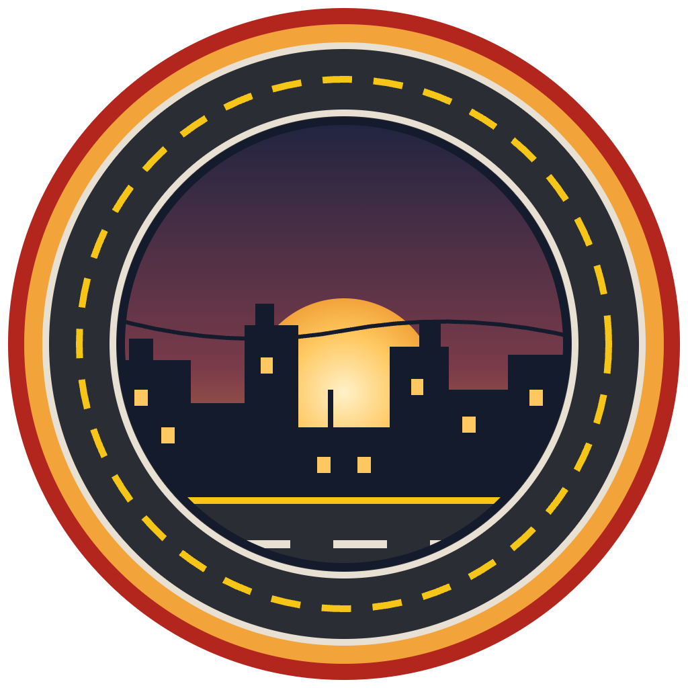
<br>
<sub>Made with ☕ cutting chai and a lot of honking.</sub>
</div>
